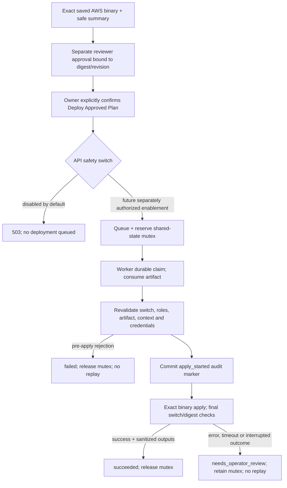

# CloudOps — System Architecture

## 1. Project Overview

CloudOps is an AI-powered self-service infrastructure
management platform.

Users will be able to request, provision, configure,
monitor, and manage AWS infrastructure through a web
dashboard.

AI will assist with planning, troubleshooting,
cost analysis, and operational recommendations.

## 2. Technology Stack

| Component | Technology |
|---|---|
| Frontend | Next.js, React, TypeScript |
| Backend | Python, FastAPI |
| Database | PostgreSQL |
| Background Jobs | Redis, Celery |
| Cloud | AWS |
| Infrastructure as Code | Terraform |
| Configuration Management | Ansible |
| Containerization | Docker |
| Orchestration | Kubernetes |
| CI | GitHub Actions |
| Enterprise Pipeline Demo | Jenkins |
| GitOps | Argo CD |
| Monitoring | Prometheus, Grafana |
| Logging | Loki |
| AI Integration | LLM API with structured outputs |

Note: SQLite will be used for the first local MVP
before moving to PostgreSQL.

## 3. High-Level Architecture

```text
             USER
               |
        Next.js Dashboard
               |
          FastAPI Backend
               |
       Authentication / RBAC
               |
       Request Validation
               |
        Approval Workflow
               |
        PostgreSQL Database
               |
        Redis Job Queue
               |
         Celery Workers
          /     |      \
         /      |       \
    Terraform Ansible  AWS SDK
         \      |       /
              AWS
               |
       EC2 / VPC / ALB / EKS

Additional components:

AI Assistant -> FastAPI -> Validated Suggestions

GitHub -> GitHub Actions -> Container Registry
                                    |
                                Argo CD
                                    |
                                Kubernetes

Prometheus + Grafana + Loki
         |
 Infrastructure and App Monitoring
```

## 4. Core Components

### Frontend

The frontend will provide:
- Infrastructure request forms
- Server management dashboard
- Job status and history
- Monitoring views
- AI assistant interface

### Backend

FastAPI will:
- Validate incoming requests
- Authenticate and authorize users
- Record infrastructure requests
- Track provisioning jobs
- Enforce security and approval policies

### Terraform

Terraform will manage the desired state of
AWS infrastructure, including:
- EC2 instances
- VPCs and subnets
- Security groups
- Load balancers
- Kubernetes infrastructure

Terraform runs will use controlled templates,
isolated remote state, locking, and approvals.

#### Day 7 local plan-only adapter

The current local MVP uses only the trusted `terraform/labs/01-foundations/`
configuration and its built-in `terraform_data` resource. FastAPI queues a
`ProvisioningJob` in SQLite; a separate polling worker atomically claims jobs
and runs fixed `init`, `validate`, and `plan` commands outside the request
handler. Each job gets a temporary working directory containing only the
lab's three `.tf` files, its own local Terraform data directory, and validated
request values passed as `TF_VAR_*` environment variables. This isolates job
state and avoids concurrent Terraform operations sharing a working directory.

Only the resource address and plan action counts are stored and returned.
Terraform's raw output and working directory are not exposed through the API.
Apply, destroy, AWS providers, cloud credentials, and infrastructure changes
are not part of this adapter. The worker must be started separately with
`python -m app.worker`.

#### Isolated Day 8/9 AWS configuration

`terraform/aws/dev/` defines a separate manually operated development environment
in `ca-central-1`: one VPC/public subnet, Internet Gateway and routing, an
outbound-HTTPS-only security group with no inbound access, and one AL2023
`t3.micro` with encrypted gp3 storage and IMDSv2. An EC2 instance profile grants
only `AmazonSSMManagedInstanceCore`. A public IPv4 provides the intended SSM
network path without NAT. Authentication uses `AWS_PROFILE`; a required account
input feeds the provider's `allowed_account_ids` guard. Day 9 configures an
encrypted S3 backend with native `.tflock` locking and private account/bucket
settings.
`terraform/bootstrap/state/` independently prepares the versioned, private,
SSE-S3-encrypted state bucket with TLS enforcement and deletion safeguards.
Its local bootstrap state requires separate protected backups and outlives dev.
This configuration is not connected to the API or worker. On November 15, 2026,
the owner used the approved workflow to create the 12 planned resources, verify
EC2 `running`, SSM `Online` and a no-drift plan, and then destroy all 12 dev
resources. The current dev resource state is empty. The retained private S3
backend, state object and bootstrap IAM resources have an independent lifecycle.
The human deployment role `cloudops-terraform-deploy` is independently
administrator-managed. The existing `cloudops-iam` browser-login profile supplies
the source identity; the proposed `cloudops-deploy` credential-process profile
supplies MFA-protected role credentials to both backend and provider. Review
templates restrict deployment grants to tagged regional dev resources, the exact
SSM role/profile and state/lock keys. They do not grant bucket administration or
deployment-role self-management. MFA-protected role authentication succeeded
for the first deployment. These live results are owner-verified; this
documentation update made no authenticated AWS calls.

#### Day 10 AWS plan-only application adapter

The existing FastAPI job API and polling worker support two explicit targets:
`local` preserves the foundations-lab workflow, while `aws_development` plans
only the fixed `terraform/aws/dev/` root. The browser cannot submit a Terraform
path or command.

AWS mode inherits no static AWS credential variables. It selects the fixed
`cloudops-deploy` profile and `ca-central-1`, then a noninteractive STS call must
return the operator-configured account and an assumed-role ARN for
`cloudops-terraform-deploy`. Missing, expired or MFA-blocked credentials fail
within a short timeout with a safe categorized message.

The backend must already be initialized manually. The worker never runs AWS
`terraform init`, migrates state or reconfigures the backend. It uses fixed
`validate`, `plan` and `show -json` argument lists, the approved working
directory, closed stdin and timeouts. Day 14 now retains the exact binary in
private artifact storage, with execution metadata in SQLite. API schemas still
exclude raw plan JSON, attributes, state and credentials; raw show output is
discarded after summary/policy validation. See the Day 14 boundary below.

A partial unique SQLite index allows only one queued/planning AWS job across all
requests. The S3 lock protects against external writers. A plan temporarily
creates and removes `.tflock`. OIDC authentication is implemented (Day 12).
Day 14 adds a separate default-disabled apply route; destroy, import and arbitrary
state mutation remain unavailable. All AWS operations still target the fixed
owner-operated development sandbox.

#### Day 11 plan approval and audit boundary

Every completed Terraform plan now receives a SHA-256 revision. AWS revisions
are derived from the complete private `terraform show -json` output before that
output is discarded; local revisions cover the validated request and plan
output. SQLite stores the digest and sanitized summary, never the raw plan.
An approval references both the provisioning job and its revision. A new plan
job therefore requires a new approval, even if its visible counts look similar.

Approval requests use `pending`, `approved`, `rejected`, and `expired` states.
Creation, decisions, and expiry append audit events in the same database
transaction as the state change. Conditional updates allow only one transition
from `pending`, including when two approvers race. SQLite triggers reject audit
event updates and deletes. The API rejects self-approval and repeated decisions.

All approval routes depend on a trusted server-side `AuthenticatedPrincipal`.
No request or decision payload contains a username. The Day 12 production
dependency independently verifies OIDC signatures, issuer, audience, expiry and
server-side roles. Missing configuration fails closed with HTTP 503. Tests use
isolated verified-token fixtures or explicit dependency overrides; browser-supplied
identity headers never satisfy authentication.

Approval records remain review evidence, never an automatic execution trigger.
Day 14 binds saved artifacts to approvals and adds a separate disabled deploy
action. There is no destroy, import, state or arbitrary-command endpoint.

#### Day 12 OIDC, RBAC and browser BFF

Auth.js implements OpenID Connect Authorization Code with PKCE, state and nonce
checks in the Next.js server. The browser receives an encrypted, HttpOnly
session cookie; its session view contains the stable subject and UI roles but no
access token. A same-origin Next.js route acts as the BFF, reads the access token
server-side and forwards it only in the FastAPI `Authorization` header.

FastAPI independently verifies the API access token with PyJWT and the trusted
JWKS. It requires a configured issuer, `cloudops-api` audience, expiry, issued-at
time, subject, access-token header type and an explicitly configured asymmetric
algorithm. The API rejects an ID token because its audience is the web client,
not the API. Missing configuration fails closed; missing/invalid authentication
returns 401 and valid identities without permission receive 403.

The local Keycloak HTTPS cutover keeps H2 in an external Docker volume and
serves the canonical issuer on loopback. The EC2 worker checks current account
status and effective realm roles through scoped Keycloak Admin API reads.
See [local Keycloak HTTPS](KEYCLOAK-LOCAL-HTTPS.md) for migration and rollback.

Both servers map the verified `issuer|subject` through the server-only
`CLOUDOPS_ROLE_ASSIGNMENTS` setting. Browser fields and token role claims do not
grant permissions. Engineers create and plan only their own requests and may
request approval. Approvers see the review queue and decide other users'
requests. Administrator alone grants no request, plan, approval or Terraform
permission. Rows created before ownership tracking have no owner and remain
inaccessible until a separately reviewed migration policy exists.

The reset control is entirely client-side. It aborts outstanding browser
requests, invalidates the current view generation and removes request, plan and
approval state from React. The polling effect also aborts during cleanup, so a
late response cannot repopulate the reset screen. Resetting never deletes
SQLite history, audit events, state or cloud resources, and it does not cancel a
job already accepted by the backend.

### Ansible

Ansible will configure provisioned VMs:
- Install Nginx
- Install Docker
- Configure applications
- Apply approved system configurations

### Kubernetes

Kubernetes will host containerized applications
and support scaling, rolling updates,
health checks, and recovery demonstrations.

### CI/CD

`.github/workflows/ci.yml` defines pull-request checks targeting `main`:
backend pytest, frontend component tests/build/type checking, and credential-free
Terraform formatting and validation for the local lab, isolated AWS root and
independent state bootstrap root.
The workflow has read-only repository permissions and no AWS authentication,
authenticated plans, infrastructure changes, image publishing or deployment.
Its first GitHub-hosted run and branch-protection setup remain to be verified.
Development uses `feature/*` branches and owner-reviewed manual PR merges.
Security scanning and container image builds remain planned.

Argo CD will reconcile Kubernetes deployments
with version-controlled configuration.

Jenkins will demonstrate a separate enterprise
automation workflow.

### Observability

Prometheus will collect metrics.
Grafana will display dashboards.
Loki will centralize application logs.

## 5. AI Integration

The AI assistant will interpret natural-language
requests and produce structured suggestions.

All AI-generated configurations must pass
backend validation and policy checks.

AI must never directly execute arbitrary
Terraform, Ansible, or shell commands.

Infrastructure changes require authorization
and an explicit approval process.

## 6. Security Principles

- No hardcoded credentials
- Least-privilege AWS IAM roles
- Protected infrastructure state
- Approved regions and resource types
- Human approval for infrastructure changes
- Audit logs for significant operations
- Separate control-plane infrastructure
- No anonymous access to provisioning APIs

## 7. Development Approach

Phase 1: Local API and validated requests
Phase 2: Database and simulated job processing
Phase 3: Terraform and Ansible integration
Phase 4: Docker, Kubernetes, and CI/CD
Phase 5: Monitoring and reliability
Phase 6: AI integration and advanced features
Phase 7: Security hardening and portfolio demo

## 8. Current Status

Phase 1 local API and persistence are implemented. The Day 7 local plan-only
workflow remains available, and Day 10 adds owner-operated real AWS planning.
AWS provisioning is implemented behind a default-disabled server switch as of
Day 14 Phase A; real application-driven AWS apply has not been enabled or tested.
The `backend/` directory lives inside the `cloudops-platform/` repository
alongside `docs/`.

- `app/main.py` defines the application factory, health and validation routes,
  and create/list/retrieve routes for persistent server requests.
- `app/schemas.py` uses Pydantic v2 models to enforce allowed server settings,
  required strict booleans, and rejection of extra fields.
- `app/models.py` defines `ServerRequest`, `ProvisioningJob`, `ApprovalRequest`,
  and append-only `ApprovalAuditEvent` tables. Server requests use a UUID string
  primary key, six configuration fields, `queued` status, and UTC creation time.
  A database uniqueness constraint covers `(environment, name)`.
- `app/database.py` creates a configurable engine and provides one session per
  API request through a FastAPI dependency. The default database is
  `backend/cloudops.db`; `DATABASE_URL` or an explicit app-factory URL overrides it.
- `tests/conftest.py` supplies isolated temporary SQLite databases.
- `tests/test_resources.py` preserves Day 2 validation coverage;
  `tests/test_server_requests.py` covers persistence and the server request API.
- `ProvisioningJob` in `app/models.py` links fixed-target plan jobs to server
  requests. Partial unique indexes permit one active job per request and only
  one active AWS plan globally.
- `app/worker.py` is a separate polling process. It atomically changes a job
  from `queued` to `planning`, validates the saved values again, runs the
  plan-only adapter, and stores either a safe summary or a generic failure.
- `app/terraform_runner.py` preserves the isolated local lab and adds the fixed
  AWS identity preflight, command allowlist, temporary plan and sanitized
  resource-action summary.
- `POST /api/v1/resources/{id}/plan` enqueues or reuses an active job.
  `GET /api/v1/jobs/{job_id}` exposes its state and sanitized summary.
- The frontend polls the job endpoint and displays the summary. Apply and
  Destroy remain disabled.

The validation endpoint returns the accepted configuration with status
`validated`. It does not persist requests or trigger infrastructure operations.
The create endpoint validates input using the same `CreateServerRequest` schema,
commits a new row, and returns HTTP 202 with the saved request. Duplicate names
within an environment produce HTTP 409 after a database constraint violation
and transaction rollback. GET endpoints return saved rows or HTTP 404.

The plan endpoint only writes a queued database row. The worker processes the
selected fixed target. Job statuses are `queued`, `planning`, `plan_ready`, and
`failed`. The summary contains no raw output, saved plan, state, attribute
values, diagnostics, or credentials.

SQLite stores creation timestamps as naive UTC values; the response schema
restores UTC timezone information when serializing them. Startup creates missing
tables and applies focused additive migrations for the plan mode and plan
revision. A general migration tool is needed before more schema changes.

OIDC authentication and RBAC are implemented and fail closed until their
identity-provider settings are supplied. A general-purpose job-processing
platform and AWS deployment execution remain planned.

### Day 4 local frontend

`frontend/` contains a Next.js App Router client with TypeScript and Tailwind CSS.
`app/page.tsx` renders the workspace; `components/create-server-form.tsx` manages
the accessible form, summary, reset state, pending state, and result feedback.
`lib/api.ts` defines approved configuration choices and sends same-origin JSON
to the Next.js BFF. The BFF attaches the server-held access token, and FastAPI
remains the authority for token validation, authorization and persistence.

The browser calls the same-origin `/api/cloudops` BFF. The server-only
`CLOUDOPS_API_URL` selects FastAPI (default `http://127.0.0.1:8000`). CORS only
allows localhost and 127.0.0.1 on port 3000, without credentials, with
Authorization/Content-Type headers. Vitest and Testing Library exercise form
behaviour using mocked fetch responses; Pytest checks CORS preflights.

### Day 13 Phase A: persisted request history

The authenticated portal reuses `ServerRequest`, `ProvisioningJob`,
`ApprovalRequest` and `ApprovalAuditEvent`. There are no new tables or schema
migrations. Auth.js, the server-held token BFF, independent FastAPI JWT checks,
server role assignments and the asynchronous worker retain their existing roles.

- `GET /api/v1/history/requests` returns an engineer's own requests, newest first,
  with the latest job and its approval. Its page envelope contains `items` and
  `has_more`; existing `/api/v1/resources` responses remain compatible.
- `GET /api/v1/history/requests/{id}` returns the request and a bounded page of
  its jobs with their approvals. Engineers must own the request. Approvers see
  only jobs with an approval record, including previous submitted revisions;
  access to one submitted job never exposes other unsubmitted jobs.
- Both history routes accept `limit` (1–50, default 20) and `offset` (0–100000).
  Ordering is creation time descending with ID tie breakers. The list uses
  bounded per-request lookups for latest jobs/approvals; query consolidation and
  cursor pagination are future scalability improvements.
- The existing approval list now supports bounded `limit`/`offset`, newest-first
  ordering, and `status=decided&mine=true` for the current approver's decisions.
  Pending filtering excludes elapsed approvals before pagination. Reading an
  elapsed approval through history or the expired list records expiration using
  the existing atomic transition and append-only audit event.
- `RequestHistory` and the extended `ApprovalQueue` fetch through the BFF with
  no-store requests, page controls, refresh, loading, empty and retry/error states.
  Details reuse the existing approval audit route. Stale read responses are
  ignored after selection changes or unmounting. History refresh is manual;
  the new-request form retains its existing job polling and reset behavior.

### Request-management reliability fixes

The portal uses a shared server-rendered shell and role-aware navigation with
separate routes: `/` (Dashboard), `/requests/new` (form), `/requests` (owned
history), `/requests/{id}` (authorized details) and `/approvals` (review queue and
the current approver's decisions). Screens check server session roles before
rendering protected components; FastAPI remains the independent authorization
authority. There are no duplicated request stores, fake counts or seeded history.
The queue links to request details for decision actions, so reviewers inspect
the plan before being offered eligible Approve/Reject controls.

The job read schema accepts safe legacy summaries that predate revision fields.
It emits `plan_revision: null` and default empty resource changes rather than
inventing a revision or allowing a response-validation HTTP 500. Worker output
still uses the strict revision-required summary schema. Approval eligibility
requires the newest job for the request to be `plan_ready`, with a valid summary
whose mode and revision match the stored job. This shared backend policy powers
history eligibility and is checked for both submission and decisions. The atomic
decision update also checks the bound revision and newest job. Old decisions
remain visible; a superseded pending approval cannot authorize the newer plan.

The continuous worker's default loop drains queued jobs and sleeps only while
idle. Both API and worker use the same absolute SQLite default; custom database
URLs must match in both processes. Unexpected runner failures are recorded with
fixed public errors and exception-class-only logs so the worker can process the
next job. Database failures use a redacted retry path. Existing atomic claims,
unique active-job limits, command allowlists and runner timeouts are retained.
There is no automatic replay of jobs stranded in `planning` after a hard crash.

The BFF uses the configured Auth.js origin's cookie security mode, forwards the
server-held access token without caching/following redirects and bounds upstream
calls with a timeout. It returns a safe HTTP 502 when FastAPI is unreachable.
Polling distinguishes permanent HTTP 401/403/404 and invalid response formats
from transient failures; only transient failures retry. An expired access token
requires sign-in again; token refresh remains future work.

Sign-out is a Next.js Server Action that clears the Auth.js session and initiates
Keycloak RP-Initiated Logout using `client_id`, an exact registered callback and
a short-lived state nonce. No token appears in client JavaScript or a logout URL.
Without `id_token_hint`, the provider requires confirmation before ending SSO.
The callback validates the HttpOnly state cookie and returns to a fixed local
page; no caller-supplied redirect is accepted. See the authentication guide for
the required Keycloak client settings. This is RP-initiated browser logout;
back-channel logout and immediate revocation of already-issued API JWTs remain
future security work.

Responses use the existing explicit public schemas, including sanitized plan
counts, addresses and lifecycle actions. Raw Terraform values/state/logs and
credentials are not included. Approval/audit timestamps are normalized to UTC
when SQLite returns naive UTC datetimes. Approval actions continue to bind one
job and revision and never trigger execution. No AI or provisioning capability
is added by this dashboard; the enterprise platform roadmap remains unchanged.

The standalone AWS exercise completed its first approved deployment and teardown on
November 15, 2026, as described above. The application deployment switch remains
off; this implementation session did not provision AWS resources.

### Day 14 Phase A: saved-plan deployment boundary (disabled)

`artifact_store.py` retains binary plans outside web-served paths with UUID-only
names, exclusive creation, size bounds, file digest verification, link/reparse
checks and service-user permissions (Windows protected DACL or POSIX 0700/0600).
`SavedPlanArtifact` stores private context and sanitized summary. Approval rows
gain a nullable `artifact_digest`; existing local/legacy approvals are not
implicitly made executable. New tables are additive; no existing request/job
status values are changed.

`aws_execution.py` independently pins account, bucket, S3 key/region/locking,
default workspace, allowed profile and exact configuration/provider-lock hashes.
It allows only create/no-op operations on the twelve existing sandbox addresses
and the existing data lookup. `deployment_policy.py` combines those checks with
current-job eligibility, expiry, digest-bound separate approval, consumption and
worker-side role revalidation. No HTTP input selects commands, paths, credentials,
accounts, environments or regions.

`deployments.py` exposes an authorized status/eligibility view and explicit
owner-only deploy queue action. The continuous worker uses `DeploymentRunner`
to verify STS role/account, validate the trusted root, inspect a verified private
copy of the exact saved binary and compare its sanitized summary. Only that
binary can reach the fixed apply argv. The server switch is checked at API,
worker/preflight and final runner boundary. It is false by default and remains
false in this implementation. New frontend controls use the existing BFF.

`TerraformStateOperation` is a unique durable mutex shared by plan/apply queues
and workers. A per-request SQLite insertion trigger also prevents replanning
while deployment is queued/running/uncertain. The native S3 lock remains enabled.
All service processes must share the same database and trusted private storage;
the application mutex does not coordinate independent databases/manual CLIs.



Deployment records preserve requester, separate approver, initiator, timestamps,
artifact digest and allowlisted resource IDs. Append-only audit events accompany
state changes and SQLite rejects event updates/deletes. A unique artifact/job
attempt prevents double execution. A crash after claim may leave `running`;
targeted offline operator recovery distinguishes a missing apply marker from
an uncertain apply, retains reservations on marking, and supports a separate
explicit release only with stopped-process and state/resource reconciliation
attestations. Consumed artifacts remain consumed; no operation is replayed.
Stranded planning jobs can be marked failed while retaining AWS reservations.
Recovery audit is append-only and stores an evidence reference, never raw state.
No lease expiry or startup retry assumes AWS did nothing. Operators still require
separate authorization for live reconciliation and any corrective AWS action.

The application does not return raw Terraform JSON, binary plans, state, arbitrary
outputs or diagnostics. Binary files can still contain sensitive data; protected
storage/retention and trusted OS identities are essential. The API/database host,
repository/configuration, credential chain and Terraform/provider installation
remain trusted. No IAM grants, backend initialization, Terraform configuration or
AWS resources were changed by this phase. See
[approved provisioning security and operator guide](APPROVED-PROVISIONING.md).

The Day 14 local launcher validates one private manifest before starting API or
worker, pins the existing SQLite path/private artifact root, fixes the AWS target
and role assignments, and rejects conflicting process settings. Apply defaults
to disabled; enabled startup requires explicit confirmation for each service and
fixed sandbox target pins. Host-local operating-system locks and durable metadata
enforce matching service and backend fingerprints while either service runs.
The agreement does not coordinate legacy entry points or other hosts. Bucket-owner
preflight uses bounded ListObjectsV2 under the existing prefix-scoped permission;
no IAM grant expansion is needed. Deployment phase/reason fields are additive
SQLite migrations and expose only allowlisted diagnostics through the BFF/UI.
See [local startup and recovery](LOCAL-OPERATIONS.md).

The explicitly selected `aws_ec2_only` plan mode uses the isolated
`terraform/aws/ec2-only` root and state key, verifies the expected network and
stores a stack, root, state and network identity with the saved plan. Both AWS
plan modes share the durable application reservation. EC2-only apply verifies the
saved plan and prior state, rechecks the network, and verifies the resulting state
and AWS instance. The legacy boundary continues to target the original root.
Both remain behind the default-off switch and explicit engineer action.

The engineer-only Infrastructure endpoint verifies the fixed AWS account and
deployment role, reads EC2 inventory and compares IDs against the isolated
EC2-only state in memory. Missing or inaccessible state yields unknown ownership;
an unmatched instance is only identified as outside this EC2-only state, not as
globally unmanaged. The page is read-only and displays recent deployment status
without exposing Terraform state, credentials or destructive controls.

Direct EC2 requests use a separate approval-to-worker flow. The worker checks
the API's shared role manifest and current Keycloak account status before claim
and again before launch. SQLite commits the execution identity, audit, and
singleton reservation together. The dedicated demo role launches with the saved
idempotency token. Uncertain outcomes keep the reservation and are reconciled
with read-only EC2 calls. See [Phase 1C execution](PHASE-1C-EXECUTION.md).

Architecture will evolve as implementation
and testing reveal new requirements.

# Phase 2 Terraform execution proposal

The [Terraform execution blueprint](PHASE-2-TERRAFORM-BLUEPRINT.md) describes
proposed offline simulation, approval binding and recovery milestones. It is a
design, not an enabled or live-verified Terraform deployment capability.
