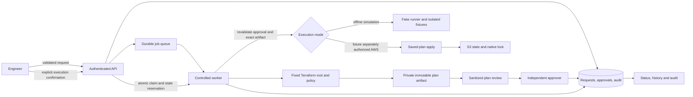

# Phase 2: Terraform execution architecture blueprint

**Status: proposed, not an implementation or authorization to apply.** Keep
AWS apply and direct EC2 Demo Mode disabled during this work. Direct EC2 is a
separate AWS API workflow and must not be represented as Terraform provisioning.
Authenticated browser verification of the newer approval workflow remains open.

## Repository findings and scope

The current application already has `ServerRequest`, `ProvisioningJob`,
`SavedPlanArtifact`, `ApprovalRequest`, `Deployment`, and their audit records.
`worker.py` claims plan jobs and deployment attempts; `terraform_runner.py`,
`deployment_runner.py`, `plan_policy.py`, `ec2_only_policy.py`, `artifact_store.py`
and `state_lock.py` implement fixed-root planning, policy, private artifacts,
guarded execution, and state reservations. `auth.py` validates Keycloak tokens
and maps stable subjects to server-controlled roles. The portal already exposes
requests, approvals, deployment history and an infrastructure page. Reuse and
incrementally extend these components rather than build another execution system.

Existing guarded apply code is implemented but disabled and has not been
verified as a live application deployment. Existing local lab plans are not
executable saved AWS plans. The direct EC2 approval and singleton reservation
remain distinct. The `terraform/aws/ec2-only` policy currently rejects real
provider-computed unknown instance-profile/template fields; unknown is not proof
of absence. Resolve that documented policy issue with evidence and tests before
any live use; never disable the validator. `terraform/aws/dev`, the isolated
`terraform/aws/ec2-only` root, and the local foundations lab are different
targets and must never share state identity accidentally.

## Proposed flow

1. The engineer creates an owned, typed request from a server-controlled catalog.
   A configuration revision is immutable after planning; editing creates a new
   revision and supersedes the prior plan and approval. Browser input never
   supplies shell commands, backend paths, credentials or arbitrary Terraform.
2. A worker atomically claims a plan job, reserves the state identity and uses
   the pinned root, Terraform/provider versions and policy to generate a saved
   plan. Store the exact binary privately and present a sanitized summary with
   unknowns, cost caveats, target, expiry and policy outcome. A plan is not an
   approval or an authorization to execute.
3. An independent approver reviews that exact summary and accepts or rejects the
   plan. Backend checks the approver role and forbids self-approval. A current,
   separately approved plan is eligible only while its request, artifact, target,
   configuration and expiration remain valid. Approval alone never starts apply.
4. The owning engineer explicitly requests execution. API and worker check the
   default-off server switch, authorization, immutable bindings, policy and
   current target identity. The worker consumes the plan once, records a durable
   execution boundary, and applies **the exact reviewed binary**. No silent
   replan, retry, or substitution is permitted. Terraform saved-plan behavior is
   documented in [HashiCorp's apply reference](https://developer.hashicorp.com/terraform/cli/commands/apply).
5. Persist sanitized status and append-only audit events at submission, plan,
   decision, claim, execution boundary and outcome. A timeout, lost worker or
   partial apply after the boundary means `needs_operator_review`, not success
   or automatic retry. Preserve all evidence and state reservations.

## Binding and authorization

The approval must cover an immutable tuple: request and requester IDs, request
configuration revision/digest, job and plan revision, exact binary SHA-256,
sanitized summary/policy result digest, target account/region/environment,
stack/root/backend identity, Terraform and provider lock identities, and expiry.
Reuse the existing artifact and approval bindings; add missing fields only after
compatibility analysis. Bind the UI review to the same tuple and do not expose
raw plan JSON, binaries, state, credentials or unrestricted logs. Saved plans
can contain sensitive values; hash is an integrity check, not encryption or a
defense against a compromised host. See [plan file guidance](https://developer.hashicorp.com/terraform/cli/commands/plan).

At approval, queue, claim and immediately before apply, re-read the database,
validate the tuple, current owner and approver authority, policy, target and
feature switch. Role changes or disabled accounts must fail closed. Current
Terraform deployment role revalidation uses the server role mapping; it is not
a current Keycloak account-enabled check. Evaluate reuse of the direct EC2
current-authority adapter, including its HTTPS/service-account prerequisites,
without weakening its or Terraform's checks. Remote identity checks cannot be
atomic with a SQLite commit: document the revocation window, bound their age,
fail closed on unavailability and recheck at the execution boundary.

Any configuration change, new plan, rejection, cancellation, expiration,
target/lockfile/policy change, stale Terraform state or uncertain artifact
invalidates eligibility. Replan and obtain a new decision. Existing legacy
records lacking required fields remain readable but cannot become executable
implicitly. Policy must fail closed for unsupported resources, destructive
actions, unknowns and unexpected plan shapes. No broad IAM permissions, direct
shell endpoint, automatic force-unlock or direct EC2 approval bypass is added.

## Persistence, APIs and screens

| Concern | Existing / proposed design |
| --- | --- |
| Request | Extend `ServerRequest` with immutable configuration revision and digest, or introduce a version table if history requires it. Keep old rows readable. |
| Plan | Reuse `ProvisioningJob` and `SavedPlanArtifact`; add explicit policy/summary and toolchain identities after migration review. Artifacts stay private and have bounded retention and an operator-reviewed cleanup policy. |
| Approval | Reuse `ApprovalRequest` and `ApprovalAuditEvent`; bind the complete tuple above. Add cancellation/revocation only with explicit state transitions and audit. |
| Execution | Reuse `Deployment` and `DeploymentAuditEvent`; unique job/artifact, durable claim/owner, timestamps and boundary marker. A server-generated idempotency key maps duplicate submissions to the same attempt, never to a second apply. |
| State lock | Extend `TerraformStateOperation` from its current fixed key to a server-derived immutable target identity. Do not treat its local SQLite mutex as a distributed lock. |
| Recovery | Reuse `OperatorRecoveryEvent`; require an authenticated, separately authorized operator procedure with evidence and append-only decisions. No browser lock-clear shortcut. |

Keep the existing `/api/v1/resources`, `/jobs/{job_id}/approvals`,
`/approvals/{approval_id}/decision`, `/jobs/{job_id}/deployment` and
`/jobs/{job_id}/deploy` contracts where practical. Proposed additive operations
are request revision, cancellation and a read-only recovery status endpoint;
define exact schemas and authorization during implementation rather than invent
client-supplied paths or commands. A repeated execution request returns the
existing attempt or a conflict; it never triggers a second apply. The request
and plan screens show target, mode, expiry and sanitized changes; Approvals
shows the exact binding; Activity shows decision and execution outcomes. Clearly
label simulation and disabled execution, and keep direct EC2 separately labeled.

Any database change requires a verified backup, additive migration and tests
against disposable copies, including old records and rollback/read compatibility.
SQLite and the existing single-host service agreement are the initial boundary;
multiple hosts require a shared transactional database and a separately reviewed
coordination design before enabling workers.

## Offline simulation and state safety

Introduce an explicit server-selected `simulation` mode with a dedicated fake
runner, fake state identity and isolated temporary database/artifact root. The
fake runner returns deterministic, typed plan fixtures and simulated execution
results without AWS credentials, network access, Terraform apply or a real
backend. It traverses the same validation, role, approval, claim and audit state
machine; simulation artifacts carry a non-executable mode marker and can never
be promoted to AWS artifacts. Tests must prove that AWS client construction,
credential loading and subprocess apply are unreachable in this mode. If desired,
the existing `terraform_data` lab may separately exercise real local plan only
with pinned providers available offline; it is not evidence of real apply.

For a future authorized deployment, isolate remote state by server-approved
account, environment and stack/key. The existing S3 backend supports native
lock files (`use_lockfile=true`); configure scoped state and lock-object access,
bucket ownership, versioning, encryption, private network access and audit only
after separate infrastructure and IAM review. The application reservation
serializes its own jobs; Terraform's S3 lock protects cooperating external
Terraform processes. Neither replaces the other. Review state versioning and
recovery against the [S3 backend documentation](https://developer.hashicorp.com/terraform/language/backend/s3).
The existing application mutex is one fixed `aws-development` key, not an
implemented per-stack distributed scheduler. Never delete a lock or state record
to hide uncertainty; operator recovery must first prove no process is active and
reconcile actual state/resources. A stale saved plan fails and requires review of
a fresh plan, not automatic regeneration or apply.

## Risks and test requirements

- Concurrent approval, cancellation, enqueue and claim: conditional updates,
  constraints and two-worker tests must show at most one attempt per artifact.
- Crash before/after boundary, timeout, lost response, partial apply or stale
  plan: preserve artifacts/audit and retain locks when effects are uncertain;
  test worker restarts and manual reconciliation without AWS mutations.
- Revoked roles, disabled accounts, unavailable authority, self-approval and
  expiry: fail closed at each boundary; test races and configuration changes.
- Binary/summary tampering, symlinks, file replacement, provider/root drift and
  unknown plan values: reject before execution and test policy bypass attempts.
- Sensitive plan/state output, secret leakage, unauthorized history access and
  forged client targets: test redaction, ownership and strict input validation.
- S3 lock contention, external writers, network partitions and backup recovery:
  use mocks for tests and require a separately authorized infrastructure review
  before any live integration. Simulated success is not proof of AWS readiness.

## Milestones and acceptance criteria

1. **Offline contract and safety tests.** Inventory current endpoints and legacy
   behavior; add simulation mode isolation tests proving no AWS credentials,
   subprocess apply or live network. Existing paths and flags remain unchanged.
2. **Immutable plan and review binding.** Add only missing version/digest fields
   with backup-safe migration; tests cover historical rows, edits, expiry,
   tampering, approvals and unsupported policy values.
3. **Simulated execution and recovery.** Exercise engineer → approver → worker
   with fake runner, atomic single-use claim, conflict and crash/uncertainty
   tests; audit every outcome. No live execution switch is enabled.
4. **Portal integration.** Extend existing screens with simulation labels,
   sanitized review and status; test RBAC, session expiry, accessibility and
   no misleading deploy controls.
5. **Live-readiness review only.** Resolve the EC2-only unknown-value policy
   issue with evidence; verify current-role authority, S3/lock/backup design and
   least privilege through separately authorized read-only checks. Live apply
   requires its own explicit operator authorization and is outside this blueprint.

**Recommended first coding task:** add a narrowly scoped simulation runner
contract and tests proving that the complete existing approval/worker path cannot
invoke AWS or Terraform apply. Do not change the live executor or the validator.
